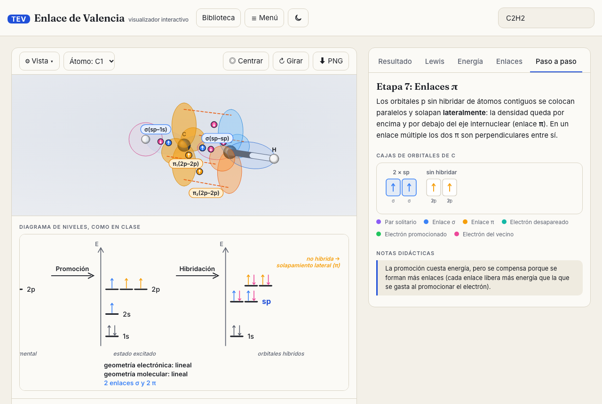
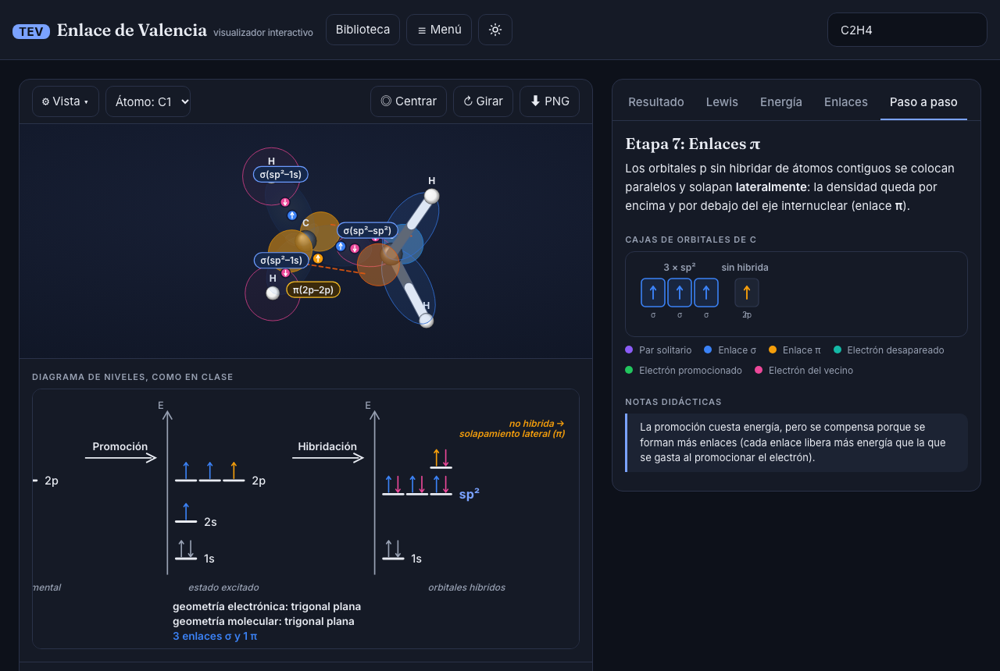
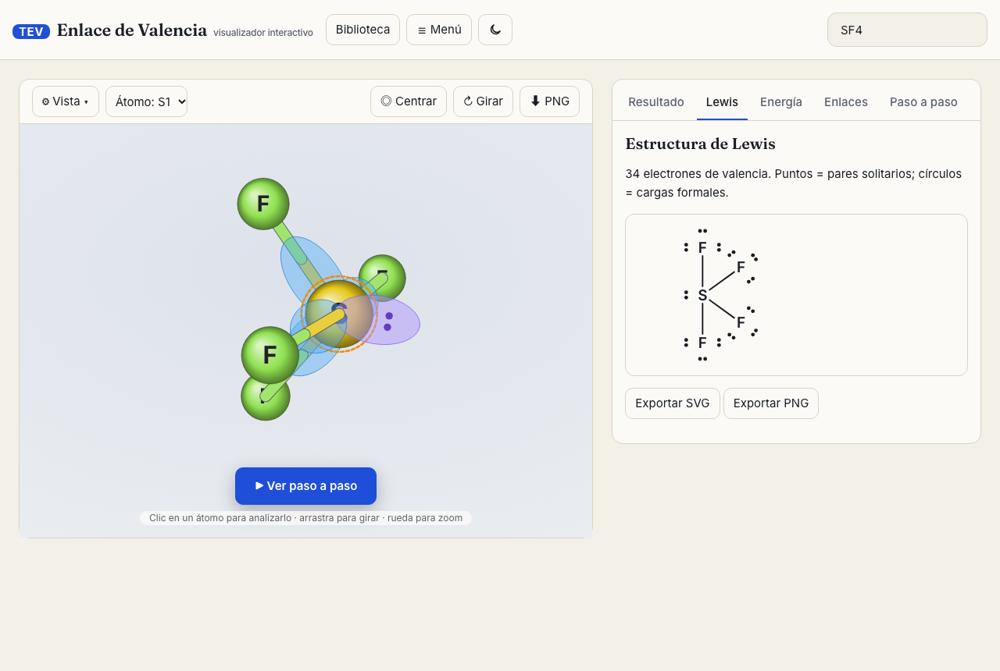
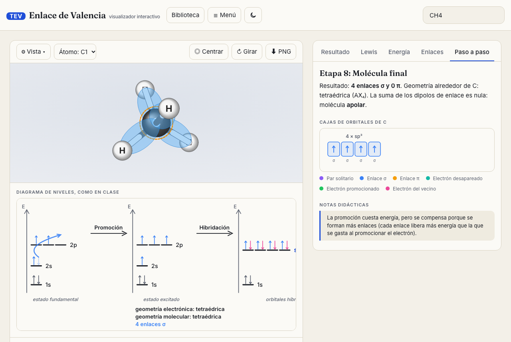

# TEV · Visualizador del Enlace de Valencia

Aplicación web interactiva para estudiar la **Teoría del Enlace de Valencia**: Lewis, RPECV, promoción, hibridación, enlaces σ/π, geometría y diagrama de energía, con una animación 3D paso a paso. Interfaz en español.

**🔗 Abrir la web: https://querymaster16-web.github.io/tev-visualizador/**

| Etapa 7: enlaces π (etino) | Etapa 7 en modo oscuro (eteno) |
|---|---|
|  |  |
| **Estructura de Lewis del SF₄** | **Molécula final (metano)** |
|  |  |

## Cómo usarla
1. Abre el enlace de arriba (o `dist/index.html` con doble clic).
2. Escribe una molécula en el buscador (nombre, fórmula o SMILES) o elige una de la **Biblioteca**.
3. Pulsa **▶ Ver paso a paso** para ver las 8 etapas, o explora las pestañas Resultado, Lewis, Energía y Enlaces.

## Uso (desarrollo)

```bash
npm install
npm run dev          # desarrollo
npm run build        # genera dist/index.html (un solo archivo, sin internet, se abre con doble clic)
npm test             # tests del motor químico (Vitest): tablas de especies, validarAnalisis() sobre toda la biblioteca, ángulos, convenios…
npm run test:visual  # prueba visual con Playwright (requiere build previo); capturas en capturas/
```

**En la app**
- **Buscador:** nombres en español (`agua`, `ácido sulfúrico`, `ion sulfato`), fórmulas (`SF4`, `NH4+`, `SO4^2-`, `CO3 2-`, `PO₄³⁻`, `[NH4]+`) o SMILES (`CCO`, `C=C`, `c1ccccc1`, `CC(=O)O`). Si la fórmula es ambigua (`C2H6O`) ofrece los isómeros de la biblioteca.
- **Reproductor:** ⏮ ◀ ▶/⏸ ▶ ⏭, barra con marcas por etapa, velocidad 0,5×/1×/2×, modo continuo o paso a paso. Teclas: ← → (etapa), espacio (reproducir/pausar).
- **Etapas:** 1 átomo aislado · 2 recuento · 3 promoción · 4 hibridación · 5 repulsión RPECV · 6 llegada de vecinos (σ) · 7 enlaces π · 8 molécula final. La etapa 7 solo aparece si hay π.
- **3D:** clic en un átomo para analizarlo, rotar/zoom/desplazar, bolas y varillas / spacefill / esqueleto, medir (2 átomos = distancia, 3 = ángulo), ejes, dipolo, ángulos, exportar PNG. «Secuencia de todos los centros» recorre cada átomo central.
- **Pestañas:** Paso a paso (cajas de orbitales), Lewis (con resonancia), Energía (4 columnas, sincronizada), Datos, Enlaces. Los diagramas se exportan a SVG/PNG.
- **Práctica** (preguntas y cajas con arrastrar electrones), **Comparar** (dos moléculas) y **Ficha A4** (impresión/PDF).
- URL compartible: `#mol=SF4&paso=5`. Tema claro/oscuro; respeta `prefers-reduced-motion`.

## Arquitectura

```
src/chem/       motor químico puro (sin DOM): elementos, parser (fórmulas/SMILES), lewis, rpecv, tev, geometria3d, biblioteca, analisis
src/viz/        Three.js: escena3d, orbitales3d (superficies + Fresnel), orbitales-atomo (estado(etapa,u) determinista), animacion/
src/diagramas/  SVG generado por código: cajas, energia, lewis2d
src/ui/         app, extras (quiz, comparador, ficha)
tests/          tev.test.ts (Vitest) y visual.spec.ts (Playwright)
```

Cada etapa de la animación es una función determinista de `(etapa, u)`, por lo que se puede saltar a cualquier punto sin saltos visuales.

## Añadir moléculas a la biblioteca

Edita `DATOS` en `src/chem/biblioteca.ts` y añade una fila: `[categoría, nombre, fórmula, SMILES?, alias?]`.
- Sin SMILES (`[I, 'Ion nitrato', 'NO3^-']`): el esqueleto se deduce (un átomo central, oxoácidos con H sobre O) y **Lewis lo calcula el algoritmo**.
- Con SMILES (`[G, 'Etanol', 'C2H5OH', 'CCO']`): se usan los órdenes de enlace y cargas escritos; necesario para orgánicas y moléculas con varios centros.
- Añade una fila a la tabla de `tests/tev.test.ts` para fijar el resultado esperado.

## Convenios y limitaciones del modelo

- Solo elementos de los grupos principales (1, 2, 13–18); los metales de transición dan un aviso claro.
- **Octeto expandido (convenio de Lewis):** por defecto se **minimizan las cargas formales**: un central del periodo ≥ 3 sube el orden de enlace con los terminales O/S/N cargados negativamente mientras su carga formal sea > 0 (SO₂, SO₃²⁻, SOCl₂, ClO₂⁻, XeOF₄, SO₄²⁻, PO₄³⁻…; modelo clásico con orbitales d, que los cálculos modernos matizan). En **⚙ Vista → Convenio de Lewis** puede elegirse «respetar el octeto»; la hibridación y la geometría no cambian, solo el número de π y la promoción (la app lo explica en una nota). Los átomos del periodo 2 nunca amplían el octeto.
- **Radicales de carbono** (CH₃·): planos sp²; el electrón desapareado no cuenta como dominio y se queda en el 2p. En NO₂ y ClO₂ el electrón sí cuenta como dominio.
- **N conjugado** (amidas, urea, anilina): sp² plano; el par ocupa un p sin hibridar y se conjuga con el π vecino. Los O–H se quedan en sp³.
- **Ángulos reales** experimentales en `ANG_EXP` (`src/chem/rpecv.ts`); la geometría 3D de las moléculas de un solo centro se construye con esos ángulos. En H₂S, PH₃, H₂Se y AsH₃ (≈ 90–93°) se avisa de que el central usa orbitales p casi puros.
- **XeF₆**: AX₆E, sp³d³, octaedro distorsionado (estructura fluxional).
- Los átomos con un solo vecino usan un p puro (interruptor «hibridar átomos terminales»).
- O₂: la TEV no explica su paramagnetismo (se remite a la TOM).
- Ángulos reales: valores aproximados de RPECV; el 3D sale de una relajación sencilla (no es un cálculo cuántico). El momento dipolar es una estimación (suma de ΔEN + pares solitarios), no un valor experimental.
- Los orbitales d y los híbridos con d se dibujan con formas aproximadas.

## Validación y tabla de la biblioteca

`validarAnalisis()` (`src/chem/validar.ts`) comprueba en los tests, para **todas** las especies de la biblioteca y con ambos convenios: Σ cargas formales = carga, electrones de Lewis = valencia, 2P + U = electrones efectivos, σ/π de la ficha = enlaces de Lewis = lista de solapamientos, composición de los híbridos y ángulos 3D = ángulo real (±3°, ±7° en moléculas con varios centros). `tests/coherencia.spec.ts` (Playwright) comprueba que Datos, Enlaces, Energía, cajas, animación y diagrama de clase salen del mismo análisis. La tabla completa está en `TABLA-BIBLIOTECA.md` (se regenera con `npx vite-node scripts/tabla.ts`).
